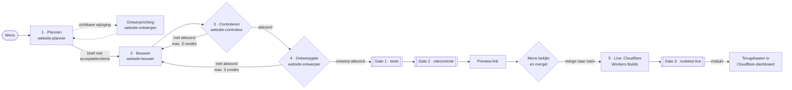

# AI-PDLC — zo komt een wijziging veilig online

Elke aanpassing aan luxmini.nl, groot of klein, doorloopt dezelfde vijf fasen. Agents doen het werk, automatische poorten (gates) vangen fouten af, en **een mens beslist wat er live gaat**.



## De fasen

| Fase | Wie | Wat | Resultaat |
|---|---|---|---|
| 1 · Plannen | `website-planner` (+ `website-ontwerper` bij zichtbare wijzigingen) | Maakt van de wens een korte brief met toetsbare acceptatiecriteria en open vragen; de ontwerper vult de ontwerprichting en ontwerpcriteria aan | `docs/wijzigingen/<datum>-<naam>.md` |
| 2 · Bouwen | `website-bouwer` | Voert de brief uit op een eigen branch, draait de tests | Commit op `wijziging/<naam>` |
| 3 · Controleren | `website-controleur` | Toetst onafhankelijk tegen de brief en `CLAUDE.md`: werking, inhoud, toegankelijkheid, techniek; past zelf niets aan | AKKOORD of verbeterpunten |
| 4 · Ontwerpgate | `website-ontwerper` (senior UX/UI) | Beoordeelt de schermen op desktop, tablet en mobiel tegen `docs/ontwerp/principes.md`, de ontwerpregels in `CLAUDE.md` en de ontwerpcriteria in de brief; past zelf niets aan | ONTWERP AKKOORD of verbeterpunten |
| 5 · Release | Mens + Cloudflare | Preview bekijken, pull request mergen; Cloudflare Workers Builds zet live, GitHub draait de rooktest | Live site + rooktest |

Starten doe je met één opdracht in Claude Code:

```
/website-update Voeg portfolio-item "Voor Lisa" toe met de foto's in ~/Downloads/lisa
```

## Poorten (gates)

| Gate | Waar en wanneer | Controleert | Bij falen |
|---|---|---|---|
| 1 · Tests | GitHub Actions, elke pull request | Formulierlogica (`npm test`), Cloudflare-configuratie (`wrangler deploy --dry-run`) | Merge-knop blijft geblokkeerd |
| 2 · Sitecontrole | GitHub Actions, elke pull request | Kapotte links en foto's, alt-teksten, horizontaal scrollen op mobiel, JavaScript-fouten, collage, hover-lijst en vaste balk (`scripts/controleer.py`), met screenshots als bijlage | Merge-knop blijft geblokkeerd |
| Mens | Vóór live | Preview-link bekeken, pull request gemerged | Niets gebeurt |
| 3 · Rooktest | GitHub Actions, na elke merge en dagelijks | Pagina's, foto's, oude Wix-adressen, 404-pagina en formulier-endpoint op de echte site (`scripts/rooktest.sh`) | Rood → terugdraaien in Cloudflare |

## Definition of Done

Een wijziging is pas klaar als:
1. alle acceptatiecriteria uit de brief gehaald zijn;
2. de controleur AKKOORD heeft gegeven;
3. de ontwerper ONTWERP AKKOORD heeft gegeven (bij wijzigingen die de bezoeker ziet; bij alleen techniek of documentatie schrijft de ontwerper "n.v.t.");
4. gates 1 en 2 groen zijn;
5. iemand de preview op desktop én telefoon heeft bekeken;
6. na het live zetten de rooktest groen is.

## Rollen en rechten

- **Agents** mogen lezen, bouwen, testen en een branch pushen. Ze mergen nooit naar `main` en zetten niets live. Dat is technisch afgedwongen: een GitHub-ruleset op `main` staat alleen pull requests met groene gates toe (zonder uitzonderingen), en `.claude/settings.json` verbiedt `wrangler deploy`, `wrangler rollback`, `git merge`, `gh pr merge` en pushen naar `main`. Er bestaat geen Cloudflare-token: alleen Cloudflare Workers Builds kan live zetten, en dat gebeurt pas na een merge.
- **De controleur** en **de ontwerper** kunnen alleen lezen; ze beoordelen hun eigen werk dus nooit. De controleur kijkt of het werkt en klopt, de ontwerper of het duidelijk, leesbaar en mooi is voor de bezoeker.
- **Ontwerpkaders:** `CLAUDE.md` (stijl) en `docs/ontwerp/principes.md` (UX). Een volledige nulmeting staat in `docs/ontwerp/review-2026-11-02.md`; die dient als ontwerpbacklog.
- **Een mens** (jij of Carien) bekijkt de preview en merget. Inhoud zoals quotes, prijzen en teksten over Carien wordt pas live gezet na haar akkoord.
- **Cloudflare Workers Builds** zet als enige live, rechtstreeks gekoppeld aan GitHub. Er zijn geen tokens of wachtwoorden in de repository of in een pipeline.

## Terugdraaien

Gaat er toch iets mis na het live zetten:
- **Snel:** Cloudflare-dashboard → Workers & Pages → `luxmini` → Deployments → vorige versie → *Rollback*. 
- **Daarna:** de fout herstellen via een nieuwe wijziging, zodat de geschiedenis op GitHub klopt.

## Meten (optioneel)

Om te zien of het proces goed werkt, kun je bijhouden:
- **Doorlooptijd:** van wens tot live (het verloop staat in elke brief).
- **First-time-right:** hoe vaak de controleur in ronde 1 akkoord geeft.
- **Change failure rate:** hoe vaak gate 3 faalt of er teruggedraaid moet worden.

## Nieuwe websites

Deze opzet is herbruikbaar. Voor een volgende site maak je een nieuwe repository vanuit deze (GitHub: *Use this template*), koppel je die eenmalig in Cloudflare (*Import a repository*) en pas je drie dingen aan:
- `name` en het domein in `wrangler.jsonc`;
- de ontwerp- en inhoudsregels in `CLAUDE.md`;
- de pagina's in `public/`.

De agents, gates en workflows blijven hetzelfde. Elke site wordt een eigen Worker in hetzelfde Cloudflare-account.
